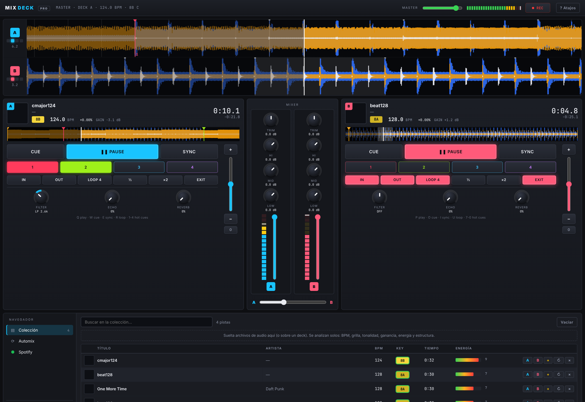
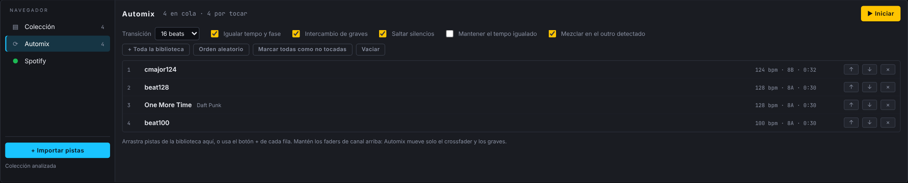
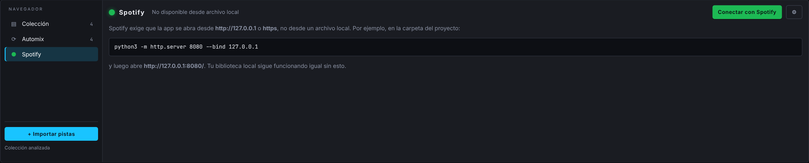

# MIXDECK · Mezclador DJ en el navegador

Prototipo funcional de un sistema de DJ que corre completo en el navegador, sin servidor ni dependencias.
Está hecho con HTML, CSS y JavaScript puro sobre la Web Audio API.

## Capturas



| Automix | Spotify |
| --- | --- |
|  |  |

## Cómo probarlo

Abre `index.html` directamente en Chrome, Edge o Firefox recientes. Si prefieres servirlo:

```bash
npx serve dj-system
```

El audio se activa con el primer clic en la página (política de autoplay de los navegadores).

## Análisis automático (estilo rekordbox)

Cada pista que importas se analiza sola, en segundo plano, y el resultado queda guardado en el navegador:

| Dato | Cómo se obtiene | Dónde se usa |
| --- | --- | --- |
| Etiquetas | ID3v2: título, artista, álbum, carátula, BPM/tonalidad si vienen | Cabecera del deck, colección, cruce con Spotify |
| BPM y grilla | Picos de energía en graves + refinamiento por coherencia de fase | Grilla en la onda, SYNC, loops, Automix |
| Tonalidad | Cromagrama por FFT contra perfiles de Krumhansl, en notación Camelot (8A, 9B…) | Badge de key; las compatibles con la pista maestra se resaltan en verde |
| Onda en 3 bandas | Graves (azul), medios (naranja) y agudos (blanco) | Ondas apiladas y vista general |
| Ganancia automática | RMS de la pista hacia -16 dBFS | Nivel parejo entre pistas sin tocar el trim |
| Energía 1-10 | Sonoridad y proporción de graves | Columna de la colección |
| Estructura | Energía de graves por compás: primer compás, drop y comienzo del outro | CUE en el primer compás, hot cue 1 en el drop, hot cue 2 en el outro, punto de salida de Automix |

## Qué incluye

- **Dos decks** con ondas ampliadas apiladas a lo ancho (8 s alrededor del cabezal, grilla de beats, contador de compás) y onda completa clicable para saltar.
- **Transporte estilo CDJ**: Play/Pause, CUE (fija, vuelve y previsualiza mientras se mantiene), 4 hot cues por deck.
- **Loops**: in/out manual, loop automático de 4 beats alineado a la grilla, mitad, doble y salir.
- **Pitch** ±16 % con lectura de porcentaje, pitch bend momentáneo y botón de reinicio.
- **Análisis automático** al importar (ver arriba) con corrección manual del BPM al hacer clic en él.
- **SYNC**: iguala el tempo con el otro deck y alinea la fase de los beats si ambos están sonando.
- **Mixer**: trim, EQ de tres bandas, medidores de nivel por canal, faders y crossfader con curva suave.
- **Efectos por deck**: filtro barrido (pasa bajos / pasa altos), eco sincronizado al tempo y reverb.
- **Grabación de la mezcla** desde el bus master, con descarga en WebM/Opus (u OGG/M4A según el navegador).
- **Navegador** con árbol lateral (Colección, Automix, Spotify, Fuentes), columnas ordenables, búsqueda, carátulas y doble clic para cargar en el deck libre. Las pistas quedan guardadas en IndexedDB.
- **Pendrive y carpetas vinculadas**: la app recuerda la carpeta, la relee al iniciar y detecta pistas nuevas o faltantes (ver abajo).
- **Controladoras MIDI**: cualquier controladora USB con modo Aprender, luces y pre-escucha por auriculares (ver abajo).
- **Google Drive**: sesión con tu cuenta de Google y carpetas compartidas vinculadas que se descargan y analizan solas (ver abajo).
- **Atajos de teclado** para todo el transporte (botón "? Atajos" o tecla `?`).
- **Automix**: arma una cola y la app mezcla sola (ver sección siguiente).
- **Spotify**: búsqueda, playlists como setlists, cruce con la biblioteca local y reproductor (ver más abajo).

## Google Drive

Cuando te comparten carpetas con música por Drive, no hace falta descargarlas a mano. En **Google Drive**:

1. Pulsa ⚙ y sigue los pasos para crear un ID de cliente de Google (gratis; la app solo pide permiso de lectura).
2. **Conectar con Google**: inicias sesión con tu cuenta. La sesión se renueva sola mientras la cuenta siga abierta.
3. Navega **Compartidos conmigo** o **Mi unidad** y pulsa **Vincular** en una carpeta. Aparece en **Fuentes** con el icono ▲.
4. La app descarga y analiza las canciones **en segundo plano** (verás "descargando" en el estado de la colección) y
   guarda una copia en el navegador: después cargan al instante y sin internet. Si agregan canciones a la carpeta, se
   detectan al abrir la app o al pulsar ↻. También puedes agregar un archivo suelto con "+ Colección".

Requiere abrir la app desde https (por ejemplo GitHub Pages) o `http://127.0.0.1`, y registrar ese origen en el ID de
cliente. No funciona en la versión publicada en claude.ai.

## Controladoras DJ (MIDI)

Sirve con cualquier controladora USB que hable MIDI estándar, que es prácticamente todas (Pioneer DDJ, Numark, Hercules,
Reloop, Denon, Traktor en modo MIDI). En el navegador, bajo **Controladora**:

1. **Conectar controladora**: el navegador pide permiso MIDI una vez y a partir de ahí la app se conecta sola al abrirla.
2. **Aprender**: pulsa "Aprender" en una función (play, cue, hot cues, loops, pitch, jog, faders, EQ, filtro, efectos,
   crossfader, navegación y carga de pistas, Automix) y mueve ese control en la controladora. Queda asignado y guardado
   para ese dispositivo. Cada mapeo tiene modo (botón, absoluto, absoluto de 14 bits para faders finos, relativo para
   jogs y encoders), inversión y luz.
3. **Preset**: hay un mapeo aproximado para Pioneer DDJ-400 / FLX4 que se carga solo al detectarla; lo que no coincida
   se corrige con Aprender. Los mapeos se exportan e importan en JSON.
4. **Luces**: los botones con estado (play, cue, sync, hot cues, loops, CUE de auriculares) se encienden en la controladora.
5. **Salida de audio y pre-escucha**: elige la tarjeta de sonido de la controladora. Si tiene 4 canales, el master sale
   por 1-2 y los auriculares por 3-4, y los botones **🎧 CUE** del mixer mandan cada deck a los auriculares antes del fader.
   La perilla PHONES controla el volumen de auriculares.

El jog wheel empuja el tempo mientras suena (nudge) y busca dentro de la pista en pausa. Web MIDI existe en Chrome y Edge
de escritorio; no en Safari ni en móviles.

## Pendrive y carpetas vinculadas

En el navegador, bajo **Fuentes**, el botón **Vincular carpeta o pendrive** abre el selector de carpetas del sistema.
A partir de ahí:

- La app **recuerda la carpeta** y la vuelve a leer cada vez que la abres: las canciones ya están en la colección al iniciar.
- Las pistas **no se copian**: se leen desde la carpeta cuando se cargan en un deck, igual que un CDJ lee el pendrive.
  El análisis (BPM, tonalidad, ondas, estructura) sí queda guardado, así que la segunda vez todo carga al instante.
- Las canciones **nuevas** se detectan y analizan solas; las que ya no están se marcan con ⊘ y se atenúan hasta que
  vuelvas a conectar el pendrive. El punto verde, amarillo o rojo junto a cada fuente indica si está conectada, si
  necesita que toques para dar permiso, o si no está.
- ↻ vuelve a leer la carpeta y × la desvincula (los archivos no se tocan).

Esto usa la API de acceso a archivos del navegador, disponible en **Chrome y Edge de escritorio**. En otros navegadores
(Firefox, Safari, móviles) el botón pasa a ser **Importar carpeta**, que copia las pistas a la colección de una vez.

## Automix: la música se mezcla sola

Arma una cola con el botón **+** de cada pista (biblioteca o playlist de Spotify que ya tengas como archivo),
arrastrando filas al panel, o con "+ Toda la biblioteca". Pulsa **▶ Iniciar** y la app:

1. Carga la primera pista en un deck y la siguiente en el otro, saltando el silencio inicial y arrancando en un
   inicio de compás.
2. Cuando a la pista le quedan N beats (4 a 64, configurable), iguala el tempo de la siguiente, la arranca alineada
   a la fase del compás y mueve el crossfader de forma gradual.
3. Durante la mezcla intercambia los graves: baja los de la pista saliente y sube los de la entrante.
4. Al terminar, pausa el deck saliente, devuelve la nueva pista a su tempo original en 8 segundos (desactivable con
   "Mantener el tempo igualado") y prepara la siguiente.

**⏭** salta de inmediato a la siguiente con la misma transición. **■ Detener** deja todo como está sonando y te
devuelve el control. Automix solo mueve el crossfader y los graves; deja los faders de canal arriba.

## Conexión con Spotify

La app se conecta a tu cuenta de Spotify con OAuth PKCE, sin servidor propio. Con eso puedes:

- Buscar en el catálogo de Spotify e importar tus playlists como setlists.
- Ver qué pistas de una playlist ya tienes como archivo en la biblioteca local y cargarlas al deck A o B con un clic.
- Escuchar la pista completa con el reproductor integrado (Web Playback SDK, requiere Spotify Premium).

### Lo que Spotify no permite

Los términos para desarrolladores de Spotify prohíben mezclar, hacer segue u overlap de su contenido con otro audio,
y el reproductor web entrega el sonido cifrado (DRM). Por eso el audio de Spotify **no pasa por el mixer**: no se le
puede aplicar EQ, pitch, loops ni efectos, y la app pausa Spotify cuando arranca un deck (y viceversa). Además,
desde noviembre de 2024 las apps nuevas no reciben BPM (`audio-features`) ni previews de 30 segundos. Para mezclar
necesitas los archivos de audio; Spotify sirve para preparar el set.

### Configuración (una sola vez)

1. Spotify exige abrir la app desde `http://127.0.0.1` o `https`, no desde un archivo local. En esta carpeta:

   ```bash
   python3 -m http.server 8080 --bind 127.0.0.1
   ```

   y abre `http://127.0.0.1:8080/`. (También sirve publicarla en GitHub Pages u otro hosting https.)
2. Entra a `developer.spotify.com/dashboard`, crea una app y en **Redirect URIs** agrega exactamente la URL que muestra
   el botón ⚙ de la sección Spotify (por ejemplo `http://127.0.0.1:8080/index.html`). Marca **Web API** y
   **Web Playback SDK**.
3. Copia el **Client ID** en el diálogo ⚙ y pulsa "Conectar con Spotify".
4. Mientras la app de Spotify esté en modo desarrollo, agrega en **User Management** las cuentas que podrán entrar (hasta 25).

## Estructura

```
dj-system/
├── index.html      Maquetado general
├── styles.css      Tema oscuro y layout responsivo
└── js/
    ├── engine.js   Contexto de audio, bus master, grabación
    ├── knob.js     Perilla rotatoria reutilizable
    ├── analyzer.js Análisis: BPM, grilla, tonalidad, bandas, ganancia, energía, estructura
    ├── tags.js     Lectura de etiquetas ID3v2
    ├── library.js  Colección, decodificación, IndexedDB
    ├── gdrive.js   Google Drive: sesión de Google, navegación y descarga
    ├── sources.js  Carpetas, pendrives y carpetas de Drive vinculadas
    ├── deck.js     Reproducción, cue, loops, pitch, sync, FX, dibujo
    ├── mixer.js    Strips de canal, medidores, crossfader
    ├── spotify.js  OAuth PKCE, búsqueda, playlists, cruce con biblioteca, reproductor
    ├── automix.js  Cola y transiciones automáticas
    ├── midi.js     Controladoras MIDI, modo Aprender, luces, salida de audio y pre-escucha
    └── app.js      Wiring, teclado, grabación, ayuda
```

## Limitaciones conocidas del prototipo

- La pre-escucha por auriculares necesita una tarjeta de sonido de 4 canales (la de la controladora) y Chrome o Edge.
- Los formatos soportados dependen del navegador (MP3, WAV, OGG y AAC funcionan en todos; FLAC no en Safari).
- La detección de BPM y de estructura funciona bien en música con pulso marcado; en material sin bajo claro conviene corregir a mano.
- La tonalidad se estima sobre toda la pista; en temas con modulaciones puede quedar en una tonalidad vecina.
- No hay cuenta de usuario ni sincronización entre dispositivos: todo vive en el navegador local.
- Spotify solo sirve para buscar, armar setlists y escuchar; su audio no se puede mezclar (ver arriba).

## Siguientes pasos sugeridos

1. Presets de fábrica para más modelos de controladoras y scratch con sensor táctil del jog.
2. Análisis por frases (8/16 compases) y detección de voces.
3. Listas de reproducción y etiquetas en la biblioteca.
4. Backend opcional para compartir bibliotecas y grabaciones entre dispositivos.
